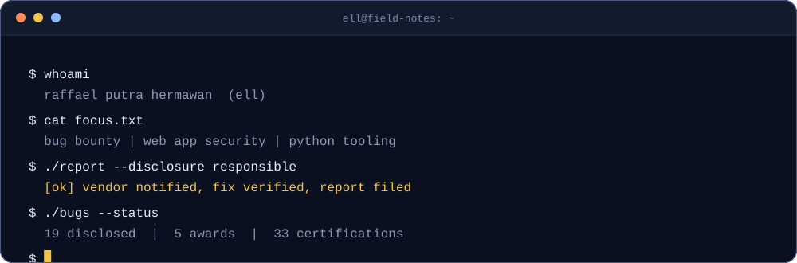
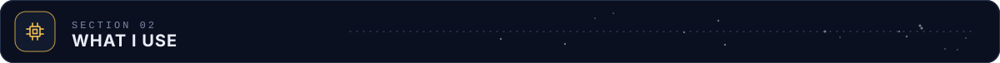
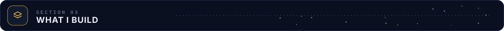
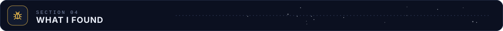
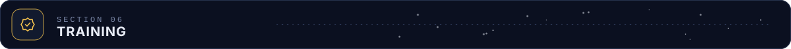
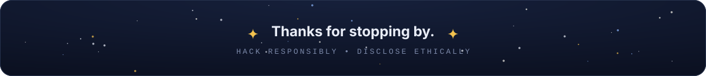

<a href="#about">About</a> &nbsp;&middot;&nbsp; <a href="#skills">Skills</a> &nbsp;&middot;&nbsp; <a href="#projects">Projects</a> &nbsp;&middot;&nbsp; <a href="#findings">Findings</a> &nbsp;&middot;&nbsp; <a href="#awards">Awards</a> &nbsp;&middot;&nbsp; <a href="#certifications">Certifications</a> &nbsp;&middot;&nbsp; <a href="#contact">Contact</a>

## About

**Raffael Putra Hermawan** (also spelled Rafael Putra Hermawan, and known online as **Ell**) is an independent cybersecurity researcher, ethical hacker, bug bounty hunter and Python developer based in Depok, Indonesia.

I am interested in information security, vulnerability research, ethical hacking and Python development. It began with simple curiosity about how systems, applications and digital infrastructure really work. That curiosity grew into finding security weaknesses, understanding the risk behind them and helping strengthen the environment around them.

I work by the principle of responsible disclosure: find it, document it, report it, never abuse it. My long-term goal is to become a cybersecurity professional, contribute to security research, collaborate with the global community and build solutions that make the digital world safer.

<table width="100%"><tr><td width="200"><b>Full name</b></td><td>Raffael Putra Hermawan</td></tr><tr><td width="200"><b>Goes by</b></td><td>Ell</td></tr><tr><td width="200"><b>Base</b></td><td>Depok, Indonesia</td></tr><tr><td width="200"><b>Focus</b></td><td>Offensive security</td></tr><tr><td width="200"><b>Second focus</b></td><td>Python development</td></tr><tr><td width="200"><b>Disclosure</b></td><td>Responsible only</td></tr><tr><td width="200"><b>Status</b></td><td>Open to work</td></tr><tr><td width="200"><b>Languages</b></td><td>Indonesian (native), English (professional), French, Russian</td></tr></table>

**Main interests**

**Principles**

### The journey so far

<table width="100%"><tr><td width="200" valign="top"><b>Grade 7</b></td><td>Wrote the first lines of code through Termux on an Android phone.</td></tr><tr><td width="200" valign="top"><b>Grade 8</b></td><td>Discovered cybersecurity through the game Watch Dogs 2 and never looked back.</td></tr><tr><td width="200" valign="top"><b>Self-study years</b></td><td>Courses, competitions, certifications and a lot of hands-on practice.</td></tr><tr><td width="200" valign="top"><b>Dec 2025</b></td><td>Joined Mavendra Ascarya as secretary of division 5.</td></tr><tr><td width="200" valign="top"><b>9 Mar 2026</b></td><td>Started applying skills legally and responsibly through responsible disclosure.</td></tr><tr><td width="200" valign="top"><b>Jun 2026</b></td><td>Recognized by the DKI Jakarta Provincial Government for a vulnerability discovery.</td></tr><tr><td width="200" valign="top"><b>Oct 2026</b></td><td>Recognized by the Bali Provincial Government for a Stored XSS discovery.</td></tr></table>

### Organizations

- **Mavendra Ascarya**: Secretary, division 5 (Sekbid 5), Dec 2025 to present
- **MPK OSIS SMAN 14 Depok**: Student council member

## Skills

Offense and defense, networks and code. Learned by breaking things I was allowed to break.

<table width="100%">
<tr><td width="64" valign="middle" align="center"></td><td width="190" valign="middle"><b>Offensive Security</b></td><td>

</td></tr>
<tr><td width="64" valign="middle" align="center"></td><td width="190" valign="middle"><b>Defensive Security</b></td><td>

</td></tr>
<tr><td width="64" valign="middle" align="center"></td><td width="190" valign="middle"><b>Networking and Wireless</b></td><td>

</td></tr>
<tr><td width="64" valign="middle" align="center"></td><td width="190" valign="middle"><b>Cryptography and Malware</b></td><td>

</td></tr>
<tr><td width="64" valign="middle" align="center"></td><td width="190" valign="middle"><b>Development</b></td><td>

</td></tr>
<tr><td width="64" valign="middle" align="center"></td><td width="190" valign="middle"><b>IoT and Embedded</b></td><td>

</td></tr>
</table>

### Toolbox

<table width="100%">
<tr><td width="190" valign="middle"><b>Recon</b></td><td>

</td></tr>
<tr><td width="190" valign="middle"><b>Scanning</b></td><td>

</td></tr>
<tr><td width="190" valign="middle"><b>Web</b></td><td>

</td></tr>
<tr><td width="190" valign="middle"><b>Exploitation and credentials</b></td><td>

</td></tr>
<tr><td width="190" valign="middle"><b>Network and wireless</b></td><td>

</td></tr>
<tr><td width="190" valign="middle"><b>Reverse and forensics</b></td><td>

</td></tr>
<tr><td width="190" valign="middle"><b>Operating systems</b></td><td>

</td></tr>
</table>

## Projects

Things I build between hunts. Public repositories live at [github.com/TheRealRafael00](https://github.com/TheRealRafael00).

<table width="100%">
<tr><td width="64" align="center" valign="middle"></td><td valign="middle"><b>Cwabs</b> </td><td valign="middle"><i>Cyber Web Analysis and Basic Scanner</i> A web analysis and basic scanning tool for first-pass reconnaissance of web applications.</td></tr><tr><td width="64" align="center" valign="middle"></td><td valign="middle"><b>PatSec</b> </td><td valign="middle"><i>Android application</i> A security-focused APK for Android, built as a hands-on mobile project.</td></tr><tr><td width="64" align="center" valign="middle"></td><td valign="middle"><b>PatSecWeb</b> </td><td valign="middle"><i>Web edition of PatSec</i> The browser version of PatSec, so the same ideas work on any screen.</td></tr><tr><td width="64" align="center" valign="middle"></td><td valign="middle"><b>Open-source tools</b> </td><td valign="middle"><i>Python tools and utilities</i> Python tools, scripts and utilities published on GitHub for the community.</td></tr><tr><td width="64" align="center" valign="middle"></td><td valign="middle"><b>Private projects</b> </td><td valign="middle"><i>Commercial and confidential</i> Commercial and confidential work that stays out of public repositories.</td></tr><tr><td width="64" align="center" valign="middle"></td><td valign="middle"><b>Learning projects</b> </td><td valign="middle"><i>Experiments and educational builds</i> Experiments and educational builds made to understand how things really behave.</td></tr><tr><td width="64" align="center" valign="middle"></td><td valign="middle"><b>Wireless protocols, network analysis and offensive security</b> </td><td valign="middle"><i>Current research</i> Current research digs into wireless protocols, traffic and network behavior, and offensive security techniques, always inside legal and authorized boundaries.</td></tr>
</table>

## Findings

Responsible disclosure log. 19 reported findings across 12 organizations. Target hostnames and technical details are withheld on purpose, because good manners are part of the job.

<table width="100%">
<tr><th>#</th><th align="left">Finding</th><th align="left">Organization</th><th>Year</th><th align="left">Reference</th></tr>
<tr><td align="right"><code>19</code></td><td><b>Exposed .git Directory</b></td><td>TNI</td><td align="center">2025</td><td></td></tr><tr><td align="right"><code>18</code></td><td><b>Reflected XSS</b></td><td>BMKG, Indonesian Meteorology, Climatology and Geophysics Agency</td><td align="center">2025</td><td><code>XSS</code></td></tr><tr><td align="right"><code>17</code></td><td><b>Sensitive Internal Configuration and Active Sentry DSN Exposed via Runtime Object</b></td><td>Zooplus</td><td align="center">2026</td><td></td></tr><tr><td align="right"><code>16</code></td><td><b>Exposed JavaScript Source Map Revealing Internal Source Files</b></td><td>U.S. Department of Defense</td><td align="center">2026</td><td></td></tr><tr><td align="right"><code>15</code></td><td><b>User Enumeration via Distinct Authentication Error Messages</b></td><td>Whoop</td><td align="center">2026</td><td></td></tr><tr><td align="right"><code>14</code></td><td><b>Exposed Sentry DSN in Production JavaScript Bundle</b></td><td>Zooplus</td><td align="center">2026</td><td></td></tr><tr><td align="right"><code>13</code></td><td><b>Unauthenticated IDOR on Cart API Exposing Shopping Data at Scale</b></td><td>Zooplus</td><td align="center">2026</td><td><code>IDOR</code></td></tr><tr><td align="right"><code>12</code></td><td><b>Exposed Telerik RadAsyncUpload and DialogHandler Endpoints</b></td><td>U.S. Department of State</td><td align="center">2026</td><td><a href="https://nvd.nist.gov/vuln/detail/CVE-2019-18935"><code>CVE-2019-18935</code></a> <a href="https://nvd.nist.gov/vuln/detail/CVE-2017-11317"><code>CVE-2017-11317</code></a></td></tr><tr><td align="right"><code>11</code></td><td><b>Missing Error Rollback Causing Persistent Orphan Wallet State Corruption</b></td><td>Chia Network</td><td align="center">2026</td><td></td></tr><tr><td align="right"><code>10</code></td><td><b>Unauthenticated Confluence REST API Exposing Internal Meeting Credentials and Personnel Data</b></td><td>NASA</td><td align="center">2026</td><td></td></tr><tr><td align="right"><code>09</code></td><td><b>Unauthenticated System Architecture Disclosure via Exposed Health Endpoints on an AI API Hub</b></td><td>NASA</td><td align="center">2026</td><td></td></tr><tr><td align="right"><code>08</code></td><td><b>Internal IP Address Disclosure via Content-Security-Policy Header</b></td><td>Jakarta Provincial Government</td><td align="center">2026</td><td></td></tr><tr><td align="right"><code>07</code></td><td><b>Publicly Accessible AEM Author Instance on Production Environment</b></td><td>NASA</td><td align="center">2026</td><td></td></tr><tr><td align="right"><code>06</code></td><td><b>Unauthenticated Access to Internal API Documentation on Staging Environment</b></td><td>NASA</td><td align="center">2026</td><td></td></tr><tr><td align="right"><code>05</code></td><td><b>No Rate Limiting on E-Learning Login</b></td><td>TNI (Mil-CSIRT)</td><td align="center">2026</td><td><a href="https://cwe.mitre.org/data/definitions/307.html"><code>CWE-307</code></a></td></tr><tr><td align="right"><code>04</code></td><td><b>No Rate Limiting on Zimbra SOAP Authentication</b></td><td>TNI (Mil-CSIRT)</td><td align="center">2026</td><td><a href="https://cwe.mitre.org/data/definitions/307.html"><code>CWE-307</code></a></td></tr><tr><td align="right"><code>03</code></td><td><b>Internal Error Field Disclosure and Single-Line CRLF Validation</b></td><td>PT Arunika Vistara Digital</td><td align="center">2026</td><td><a href="https://cwe.mitre.org/data/definitions/209.html"><code>CWE-209</code></a> <a href="https://cwe.mitre.org/data/definitions/93.html"><code>CWE-93</code></a></td></tr><tr><td align="right"><code>02</code></td><td><b>Contact Form Server Action Rate Limiting Deficiency</b></td><td>PT Arunika Vistara Digital</td><td align="center">2026</td><td><a href="https://cwe.mitre.org/data/definitions/799.html"><code>CWE-799</code></a></td></tr><tr><td align="right"><code>01</code></td><td><b>Stored XSS on News Page</b></td><td>Bali Provincial Government</td><td align="center">2026</td><td><code>XSS</code></td></tr>
</table>

## Awards

Recognition earned in the field. Awards and letters of appreciation from governments, companies and competitions. The documents themselves are shown in full on the website.

<table width="100%">
<tr><td width="64" align="center" valign="middle"></td><td valign="middle"><b>Stored XSS on News Page</b> Bali Provincial Government</td><td valign="middle" align="right"><code>Oct 2026</code></td></tr><tr><td width="64" align="center" valign="middle"></td><td valign="middle"><b>Letter of Recognition and Appreciation</b> PT Arunika Vistara Digital (Digifolks)</td><td valign="middle" align="right"><code>Recognition</code></td></tr><tr><td width="64" align="center" valign="middle"></td><td valign="middle"><b>Certificate of Appreciation</b> PT Arunika Vistara Digital (Digifolks)</td><td valign="middle" align="right"><code>Appreciation</code></td></tr><tr><td width="64" align="center" valign="middle"></td><td valign="middle"><b>Appreciation Certificate</b> DKI Jakarta Provincial Government</td><td valign="middle" align="right"><code>Jun 2026</code></td></tr><tr><td width="64" align="center" valign="middle"></td><td valign="middle"><b>National Informatics Competition</b> Olimnesia and Mapresnas</td><td valign="middle" align="right"><code>Competition</code></td></tr>
</table>

## Certifications

Courses, exams and seminars. 33 certificates from global providers and national programs, grouped by topic. The documents themselves are shown in full on the website, where they can be searched by title or provider.

### Cybersecurity foundations

 

<table width="100%">
<tr><th align="left">#</th><th align="left">Certification</th><th align="left">Provider</th></tr>
<tr><td><code>01</code></td><td><b>CC Course Conclusion</b></td><td>ISC2</td></tr><tr><td><code>07</code></td><td><b>Cybersecurity Fundamentals</b></td><td>IBM Skills Build</td></tr><tr><td><code>08</code></td><td><b>CompTIA Security+</b></td><td>Cursa</td></tr><tr><td><code>11</code></td><td><b>Introduction to Cybersecurity</b></td><td>Cisco Networking Academy</td></tr><tr><td><code>12</code></td><td><b>Cybersecurity for Business</b></td><td>EC-COUNCIL</td></tr><tr><td><code>13</code></td><td><b>Introduction to Cybersecurity</b></td><td>Cyberacademy.id</td></tr><tr><td><code>14</code></td><td><b>IT Security by Google Careers</b></td><td>Cursa</td></tr><tr><td><code>16</code></td><td><b>Fortinet Certified Associate in Cybersecurity</b></td><td>Fortinet</td></tr><tr><td><code>20</code></td><td><b>CyberSecurity</b></td><td>ADBI Institute</td></tr>
</table>

### Ethical hacking and offensive security

 

<table width="100%">
<tr><th align="left">#</th><th align="left">Certification</th><th align="left">Provider</th></tr>
<tr><td><code>03</code></td><td><b>Intro to Dark Web, Anonymity and Cryptocurrency</b></td><td>EC-COUNCIL</td></tr><tr><td><code>05</code></td><td><b>Cybersecurity Essentials with Kali Linux</b></td><td>BISA AI</td></tr><tr><td><code>09</code></td><td><b>Ethical Hacker</b></td><td>Cisco Networking Academy</td></tr><tr><td><code>10</code></td><td><b>Ethical Hacking: Introduction</b></td><td>Cybrary</td></tr><tr><td><code>19</code></td><td><b>Ethical Hacker for Dummies</b></td><td>Komdigi / Kominfo</td></tr><tr><td><code>21</code></td><td><b>Certificate of Participation</b></td><td>HackerVerse / EC-COUNCIL</td></tr><tr><td><code>28</code></td><td><b>Webinar Broken Access Control</b></td><td>Merdeka Siber</td></tr>
</table>

### Cryptography and threat intelligence

 

<table width="100%">
<tr><th align="left">#</th><th align="left">Certification</th><th align="left">Provider</th></tr>
<tr><td><code>02</code></td><td><b>Classical Cryptography for Beginners</b></td><td>Cyberacademy.id</td></tr><tr><td><code>06</code></td><td><b>Cyber Threat Intelligence 101</b></td><td>arcX</td></tr>
</table>

### Cloud and DevSecOps

 

<table width="100%">
<tr><th align="left">#</th><th align="left">Certification</th><th align="left">Provider</th></tr>
<tr><td><code>18</code></td><td><b>DevSecOps in AWS Course</b></td><td>Codecademy</td></tr><tr><td><code>30</code></td><td><b>Securing and Protecting Your Data in Amazon S3</b></td><td>AWS Training and Certification</td></tr>
</table>

### AI and prompt engineering

 

<table width="100%">
<tr><th align="left">#</th><th align="left">Certification</th><th align="left">Provider</th></tr>
<tr><td><code>04</code></td><td><b>ChatGPT for Cybersecurity</b></td><td>Simplilearn</td></tr><tr><td><code>17</code></td><td><b>Prompt Engineering</b></td><td>Codecademy</td></tr><tr><td><code>26</code></td><td><b>Basic AI Fundamentals</b></td><td>Dicoding, Indosat, Google Cloud</td></tr><tr><td><code>31</code></td><td><b>Claude 101</b></td><td>Anthropic</td></tr><tr><td><code>32</code></td><td><b>Claude Code in Action</b></td><td>Anthropic</td></tr><tr><td><code>33</code></td><td><b>Modular Summit 2026: Optimizing Artificial Intelligence in Student Learning</b></td><td>Kemendikdasmen</td></tr>
</table>

### Data, SQL and analytics

 

<table width="100%">
<tr><th align="left">#</th><th align="left">Certification</th><th align="left">Provider</th></tr>
<tr><td><code>15</code></td><td><b>Google Analytics Certification</b></td><td>Google</td></tr><tr><td><code>23</code></td><td><b>SQL Basic</b></td><td>HackerRank</td></tr><tr><td><code>24</code></td><td><b>SQL Intermediate</b></td><td>HackerRank</td></tr><tr><td><code>25</code></td><td><b>SQL Advanced</b></td><td>HackerRank</td></tr>
</table>

### Linux, seminars and awareness

 

<table width="100%">
<tr><th align="left">#</th><th align="left">Certification</th><th align="left">Provider</th></tr>
<tr><td><code>22</code></td><td><b>How to Prevent E-Waste?</b></td><td>United Nations</td></tr><tr><td><code>27</code></td><td><b>Seminar Nasional IT Holic</b></td><td>Himatif UTB</td></tr><tr><td><code>29</code></td><td><b>Building a Virtual Lab and Linux Basics</b></td><td>Digital Talent Scholarship, Komdigi</td></tr>
</table>

## Contact

Let us work on something secure. Email gets a reply within 48 hours.

<table width="100%"><tr><td width="64" align="center"></td><td width="200"><b>Email</b></td><td><a href="mailto:raffael.dev.sec@gmail.com">raffael.dev.sec@gmail.com</a></td></tr><tr><td width="64" align="center"></td><td width="200"><b>Website</b></td><td><a href="https://raffaelsec.my.id">raffaelsec.my.id</a></td></tr><tr><td width="64" align="center"></td><td width="200"><b>LinkedIn</b></td><td><a href="https://www.linkedin.com/in/raffael-sec/">linkedin.com/in/raffael-sec</a></td></tr><tr><td width="64" align="center"></td><td width="200"><b>GitHub, projects</b></td><td><a href="https://github.com/TheRealRafael00">@TheRealRafael00</a></td></tr><tr><td width="64" align="center"></td><td width="200"><b>GitHub, main</b></td><td><a href="https://github.com/faelll14">@faelll14</a></td></tr><tr><td width="64" align="center"></td><td width="200"><b>Instagram</b></td><td><a href="https://www.instagram.com/ell_bugs">@ell_bugs</a></td></tr></table>

> **Legal notice.** Copyright (c) 2025-2026 Raffael Putra Hermawan. All rights reserved. The text, design, source code, graphics, structure and every other original element of this repository and of [raffaelsec.my.id](https://raffaelsec.my.id) are protected under Law No. 28 of 2014 on Copyright of the Republic of Indonesia and applicable international treaties. Certificates and documents shown here remain the property of their respective issuers and are displayed for portfolio purposes only.
>
> Copying, scraping, mirroring, cloning, reproducing, redistributing, republishing screenshots, or reverse engineering any part of this content, including the certificate documents, without prior written permission is prohibited. Unauthorized access to, extraction of, or circumvention of protection measures on electronic information may also violate Law No. 11 of 2008 on Electronic Information and Transactions, as amended. Automated collection by bots and crawlers, and use for AI or machine learning training, is not permitted. For permission requests, write to raffael.dev.sec@gmail.com.

Copyright (c) 2025-2026 Raffael Putra Hermawan. All rights reserved. See <a href="LICENSE">LICENSE</a>. &nbsp;&middot;&nbsp; <a href="https://raffaelsec.my.id">raffaelsec.my.id</a>

